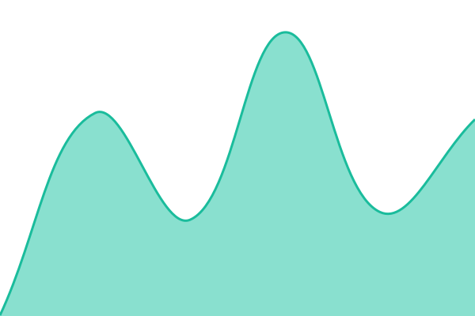

# [📈 Live Status](https://aselestov81-wq.github.io/status): <!--live status--> **🟩 All systems operational**

This repository contains the open-source uptime monitor and status page for [aselestov81-wq](https://aselestov81-wq.github.io/status), powered by [Upptime](https://github.com/upptime/upptime).

With [Upptime](https://upptime.js.org), you can get your own unlimited and free uptime monitor and status page, powered entirely by a GitHub repository. We use [Issues](https://github.com/aselestov81-wq/status/issues) as incident reports, [Actions](https://github.com/aselestov81-wq/status/actions) as uptime monitors, and [Pages](https://aselestov81-wq.github.io/status) for the status page.

<!--start: status pages-->
<!-- This summary is generated by Upptime (https://github.com/upptime/upptime) -->
<!-- Do not edit this manually, your changes will be overwritten -->
<!-- prettier-ignore -->
| URL | Status | History | Response Time | Uptime |
| --- | ------ | ------- | ------------- | ------ |
|  [maksim-shelestov](https://maksim-shelestov.vercel.app/) | 🟩 Up | [maksim-shelestov.yml](https://github.com/aselestov81-wq/status/commits/HEAD/history/maksim-shelestov.yml) | 

 131ms
     
 | 

<a href="https://aselestov81-wq.github.io/status/history/maksim-shelestov">100.00%</a>
    

|  [plush](https://plush-liard.vercel.app/) | 🟩 Up | [plush.yml](https://github.com/aselestov81-wq/status/commits/HEAD/history/plush.yml) | 

 306ms
     
 | 

<a href="https://aselestov81-wq.github.io/status/history/plush">100.00%</a>
    

|  [emal](https://maksim-shelestov.vercel.app/emal/index.html) | 🟩 Up | [emal.yml](https://github.com/aselestov81-wq/status/commits/HEAD/history/emal.yml) | 

 110ms
     
 | 

<a href="https://aselestov81-wq.github.io/status/history/emal">100.00%</a>
    

|  [ladom](https://ladom.vercel.app/) | 🟩 Up | [ladom.yml](https://github.com/aselestov81-wq/status/commits/HEAD/history/ladom.yml) | 

 368ms
     
 | 

<a href="https://aselestov81-wq.github.io/status/history/ladom">100.00%</a>
    

|  [schastlivye-detki](https://schastlivye-detki.vercel.app/) | 🟩 Up | [schastlivye-detki.yml](https://github.com/aselestov81-wq/status/commits/HEAD/history/schastlivye-detki.yml) | 

 175ms
     
 | 

<a href="https://aselestov81-wq.github.io/status/history/schastlivye-detki">100.00%</a>
    

|  [svoya-orbita](https://svoya-orbita.vercel.app/) | 🟩 Up | [svoya-orbita.yml](https://github.com/aselestov81-wq/status/commits/HEAD/history/svoya-orbita.yml) | 

 289ms
     
 | 

<a href="https://aselestov81-wq.github.io/status/history/svoya-orbita">100.00%</a>
    

<!--end: status pages-->

[**Visit our status website →**](https://aselestov81-wq.github.io/status)

## 📄 License

- Powered by: [Upptime](https://github.com/upptime/upptime)
- Code: [MIT](./LICENSE) © [Anand Chowdhary](https://anandchowdhary.com)
- Data in the `./history` directory: [Open Database License](https://opendatacommons.org/licenses/odbl/1-0/)
